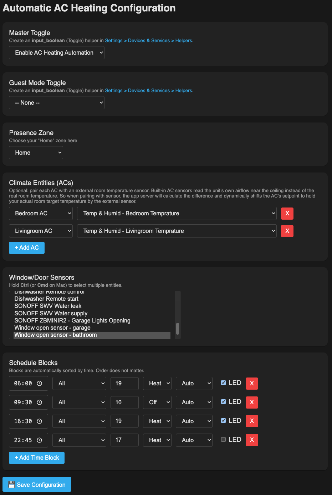

# Automatic AC & Heating Scheduler for Home Assistant

A smart, set-and-forget climate scheduler for Home Assistant. This app gives you a simple web interface to schedule your AC heating, while automatically turning them off if you leave a window open or leave the house.

## Why use this?

Instead of building complex Home Assistant automations for every scenario, this app handles the heavy lifting in one place:

* **Save Energy:** Automatically turns off the AC if a window or door is left open.
* **Smart Presence:** Shuts off the AC when everyone leaves the house (with an optional override for when guests are visiting).
* **Dynamic Room Temperature Compensation:** Pair any AC with an external room temperature sensor so the scheduler shifts the AC setpoint based on the difference between the AC's built-in sensor and your actual room sensor.
* **Flexible Scheduling:** Set different temperatures, HVAC modes and fan speeds for specific times of day—either across all ACs or targeted to a single AC.
* **Stay Informed:** Sends Home Assistant notifications when turning off climate control for an empty house, open window, or scheduled `off` block, when enforcing schedule/mode transitions, or when an AC or room temperature sensor goes offline (without repeating spam every minute).

## Installation

Click the badge above, or add the repository manually:

1. Open your Home Assistant and go to **Settings** > **Apps** > **App Store**.
2. Click the three dots (`...`) in the top right corner and select **Repositories**.
3. Paste this URL and click **Add**: `https://github.com/liorwohl/homeassistant-automatic-ac-heating`
4. Close the modal, scroll down to **My Custom Apps** (or search for **Automatic AC Heating**), and click it.
5. Click **Install**.
6. Toggle on **Show in sidebar** and click **Start**.

## How to Configure

Once started, click the **Automatic AC Heating** icon in your Home Assistant sidebar. The interface loads your entities directly from Home Assistant:

* **Master Toggle:** Pick an `input_boolean` helper to enable or pause automation, and use the switch on the left side of the box to toggle its state directly from the UI.
* **Guest Mode (Optional):** Pick an `input_boolean` helper that keeps climate control running when guests are over even if the main presence zone is empty.
* **Presence Zone:** Pick your home zone (e.g., `zone.home`) so the system knows when nobody is home.
* **Climate Entities (ACs):** Add your climate entities and optionally pair each one with an external `temperature` sensor for dynamic setpoint compensation.
* **Window/Door Sensors:** Select `binary_sensor` entities for windows or doors; if any are `on`, active AC units are turned off.
* **Schedule Blocks:** Add time blocks (`HH:MM`) targeting `All` ACs or an individual AC.