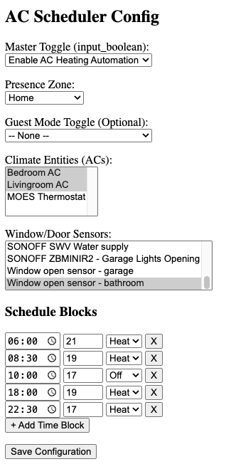

# Automatic AC & Heating Scheduler for Home Assistant

A smart, set-and-forget climate scheduler for Home Assistant. This app gives you a simple web interface to schedule your AC and heating, while automatically turning them off if you leave a window open or leave the house.

## Why use this?

Instead of building complex Home Assistant automations for every scenario, this app handles the heavy lifting in one place:

* **Save Energy:** Automatically turns off the AC/Heater if a window or door is left open.

* **Smart Presence:** Shuts off the climate control when everyone leaves the house (with an optional override for when guests are visiting).

* **Easy Scheduling:** Set different temperatures and modes (heat, cool, dry, off) for different times of the day using a clean, built-in dashboard.

* **Stay Informed:** Sends a standard Home Assistant notification if it turns off your AC due to an open window or empty house, and another when it turns it back on.

## Installation

1. Open your Home Assistant and go to **Settings** > **Apps** > **App Store**.

2. Click the three dots (`...`) in the top right corner and select **Repositories**.

3. Paste this URL and click **Add**: `https://github.com/liorwohl/homeassistant-automatic-ac-heating`

4. Close the modal, scroll down to **My Custom Apps** (or search for "Automatic AC Heating"), and click it.

5. Click **Install**.

6. Toggle on **Show in sidebar** and click **Start**.

## How to Configure

Once started, click the new **Automatic AC Heating** icon in your Home Assistant sidebar. The interface will automatically load your existing entities.

Simply select your devices from the dropdown menus:

* **Master Toggle:** Pick an `input_boolean` switch to easily pause the whole schedule when you don't want it running.

* **Presence Zone:** Pick your home zone (e.g., `zone.home`) so the system knows when the house is empty.

* **Guest Mode (Optional):** Pick an `input_boolean` that tells the system guests are over, so it won't shut off the AC when you leave.

* **Climate Entities:** Pick the AC units or heaters you want to control.

* **Window/Door Sensors:** Pick the sensors for your windows and doors. If any of these are opened, the AC stops.

* **Schedule:** Add your daily schedule (e.g., "At 07:00, set to Heat at 22°C"). The system automatically adjusts to the correct setting for the current time.